<p align="center">
  <picture>
    <source media="(prefers-color-scheme: dark)" srcset="frontend/assets/logo-dark.svg">
    
  </picture>
</p>

# ParkWise — Smart Parking Management System

A local web application for running a single parking facility. The user
interface is plain HTML, CSS and JavaScript; every parking rule — slot
allocation, billing, reservation conflicts, the waiting queue and saving to
disk — is implemented in **C++17** behind a small HTTP API.

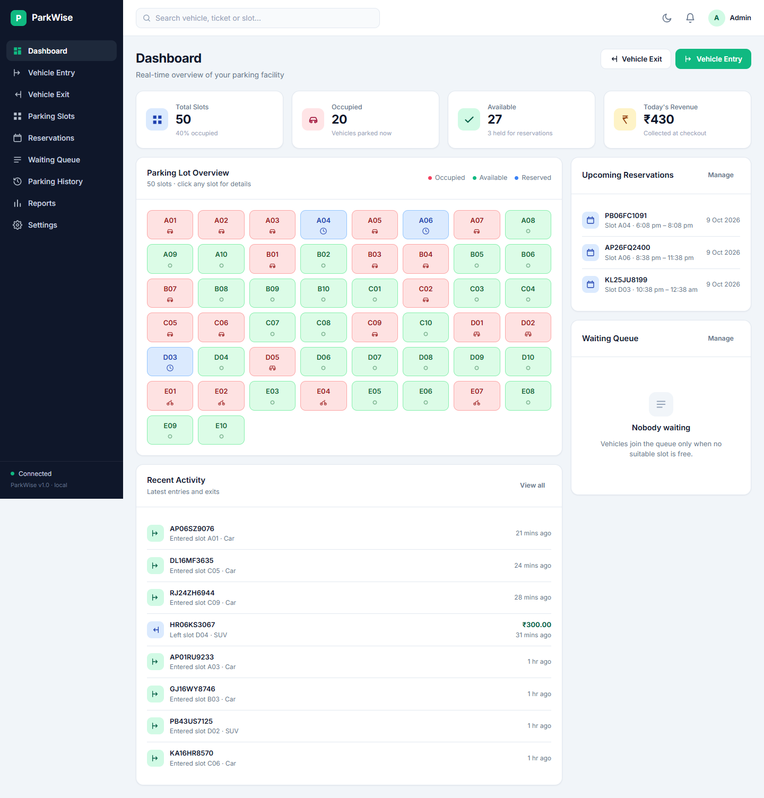

---

## Table of contents

1. [What it does](#what-it-does)
2. [Setting up the tools](#setting-up-the-tools)
3. [Building and running](#building-and-running)
4. [Publishing it](#publishing-it)
5. [Running the tests](#running-the-tests)
6. [Screens](#screens)
7. [Architecture](#architecture)
8. [The C++ classes](#the-c-classes)
9. [How billing works](#how-billing-works)
10. [How reservations and the queue interact](#how-reservations-and-the-queue-interact)
11. [How data is stored](#how-data-is-stored)
12. [API reference](#api-reference)
13. [OOP concepts demonstrated](#oop-concepts-demonstrated)
14. [A five minute demo](#a-five-minute-demo)
15. [Known limitations](#known-limitations)
16. [Project layout](#project-layout)

---

## What it does

- **Vehicle entry** — register a vehicle and have a compatible slot allocated.
- **Vehicle exit** — close a session and charge an hourly-ceiling fee.
- **Parking slots** — a live grid of the facility with a detail panel per slot.
- **Advance reservations** — hold a slot for a future interval, with conflict
  checking, check-in during a grace period, cancellation and expiry.
- **Waiting queue** — when the facility is full, vehicles queue and are admitted
  automatically as soon as a compatible slot is released.
- **Parking history** — search, filter by status and date, and export to CSV.
- **Reports** — vehicles served, revenue, average duration, peak hour, plus a
  revenue-by-day bar chart and a vehicle-type donut.
- **Printable tickets** — a clean white ticket from the browser's print dialog.
- **Settings** — hourly rates, grace period, the slot layout, and backups.

Everything shown on screen is calculated by the C++ backend. The browser never
decides a slot, a fee or a conflict.

---

## Setting up the tools

You need two things on your `PATH`: **CMake 3.20+** and a **C++17 compiler**.

### Option A — MinGW-w64 (no admin rights needed)

This is what the project was developed and tested with.

1. Download a MinGW-w64 build from
   [WinLibs](https://winlibs.com/) — pick the **UCRT, POSIX threads, x86_64**
   `.zip`. This project was built with **GCC 16.2.0**.
2. Extract it, for example to `C:\toolchains\mingw64`.
3. Download the **Windows x86_64 ZIP** of
   [CMake](https://cmake.org/download/) and extract it, for example to
   `C:\toolchains\cmake`.
4. Add both `bin` folders to your `PATH` for the session:

   ```bat
   set PATH=C:\toolchains\mingw64\bin;C:\toolchains\cmake\bin;%PATH%
   ```

> **A note on older MinGW installs.** The very common MinGW.org build
> (`gcc 6.3.0`, found at `C:\MinGW`) **will not work**. It uses the `win32`
> thread model, so it has no `<thread>` or `<mutex>`, which `cpp-httplib`
> requires, and its C++17 support is incomplete. Check what you have with
> `g++ -v` — you want `Thread model: posix` and GCC 9 or newer.

### Option B — Visual Studio

Install **Visual Studio 2019 or newer** with the *Desktop development with C++*
workload. It ships CMake. Then build from a *Developer Command Prompt*.

### Dependencies

Both third-party libraries are header-only and are **already included** in
`third_party/`, so there is nothing to download or install:

| Library | Version | Used for |
|---|---|---|
| [cpp-httplib](https://github.com/yhirose/cpp-httplib) | 0.18.3 | The HTTP server |
| [nlohmann/json](https://github.com/nlohmann/json) | 3.11.3 | Reading and writing JSON |

---

## Building and running

From the `ParkWise` folder:

```bat
build.bat
run.bat
```

Or, doing the same thing by hand:

```bat
cmake -S . -B build -DCMAKE_BUILD_TYPE=Release
cmake --build build --config Release
build\bin\parkwise.exe
```

Then open **http://127.0.0.1:8080**.

With MinGW the executable is linked statically, so `parkwise.exe` runs on its
own without needing any compiler DLLs alongside it.

### Command line options

| Option | Default | Meaning |
|---|---|---|
| `--port <number>` | `8080` | Port to listen on |
| `--host <address>` | `127.0.0.1` | Interface to bind to |
| `--data <folder>` | `data/` beside the project | Where records are stored |
| `--frontend <folder>` | `frontend/` beside the project | Where the web files are |
| `--demo` | off | Public copy: refuse settings changes, reset the records periodically |
| `--reset-minutes <n>` | `30` | How often `--demo` resets. `0` never resets |

The server binds to `127.0.0.1` on purpose: it is reachable only from this
computer and is not exposed to the network.

### Filling the car park with sample records

A fresh clone starts with an empty car park, because `data/` holds live records
and is not kept in version control. To see the dashboard, reports and charts
with something in them:

```
python tools/seed_demo.py data
```

That writes a believable day: around 30 vehicles parked, roughly 140 finished
sessions over the past week, three upcoming bookings, and one bike waiting
because every bike bay is full. Every record is one the server itself could
have produced — the fees follow the started-hour rule, and the bike is only in
the queue because row E really is full.

It **replaces** whatever is in the folder it is given, so point it somewhere
else (`python tools/seed_demo.py demo-data`) if the current records matter, and
start the server with `--data demo-data`.

---

## Publishing it

ParkWise has no user accounts — the brief placed them outside this version — so
a copy on a public address would let any visitor change the rates or delete the
slot layout. `--demo` is the answer to that without inventing a login system
the rest of the program has no notion of:

```
parkwise --host 0.0.0.0 --demo --reset-minutes 30
```

| | |
|---|---|
| Parking, exits, bookings and the queue | **Work normally** — trying them is the point of publishing it |
| `PUT /api/settings`, `POST /api/settings/backup` | **Refused** with `403 DEMO_READ_ONLY` |
| The records | **Put back** to how they started every 30 minutes |

The boundary is drawn there because a reset undoes a parked car soon enough to
be harmless, but a visitor who empties the slot layout leaves the car park
looking broken to everyone who arrives before the next reset.

The rule is applied once, in a pre-routing handler in `ApiServer`, so no
handler has to remember it and a route added later is covered without being
told. The browser asks `GET /api/meta` as it loads, shows a **Demo** badge in
the top bar, and renders the Settings screen read-only, so nothing is offered
that the server will refuse.

A `Dockerfile` is included. It compiles the program, **runs the test suite and
fails the build if any check fails**, seeds a car park with `tools/seed_demo.py`,
and starts in demo mode as a non-root user:

```
docker build -t parkwise .
docker run -p 8080:8080 parkwise
```

cpp-httplib is built here without OpenSSL, so the program speaks plain HTTP.
Put it behind a host that terminates TLS for you rather than exposing it
directly.

---

## Running the tests

```bat
test.bat
```

or `build\bin\parkwise_tests.exe`, or `ctest --test-dir build`.

The tests drive `ParkingLot` and its helpers directly, without a browser and
without the HTTP server. They cover billing boundaries, entry and exit,
reservation conflicts and expiry, queue ordering, settings validation, reports,
CSV escaping, backup pruning, demo mode and — most importantly — persistence: that records survive a
restart, that a damaged file is never silently wiped, and that a save which
fails leaves nothing half-done.

Current result:

```
320 of 320 checks passed
All checks passed.
```

---

## Screens

| | |
|---|---|
| **Dashboard** — top-down map of the car park, occupancy, hourly traffic, activity | **Parking Slots** — the same map with a persistent bay-details panel |
|  | 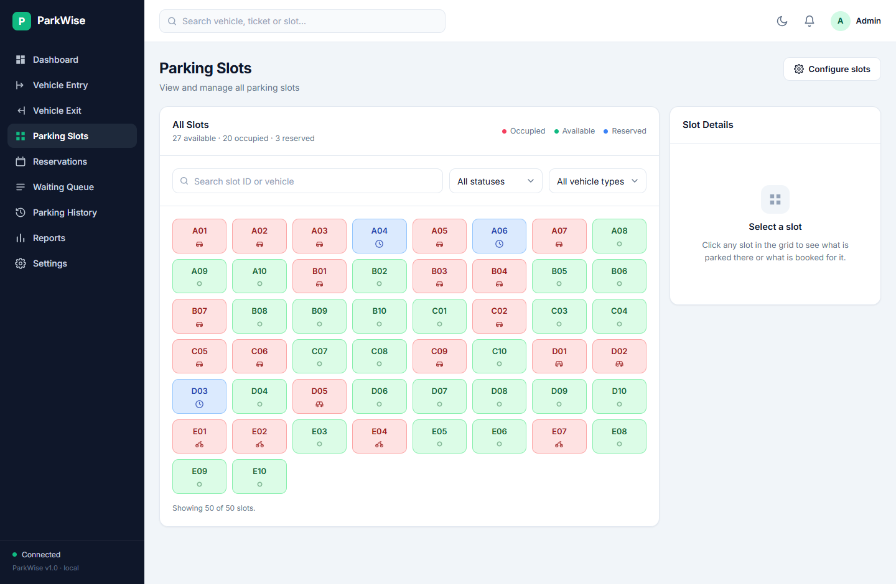 |
| **Vehicle Entry** — type tiles with live free counts; the allocated bay shown on its row | **Vehicle Exit** — search, confirm the fee, check out |
| 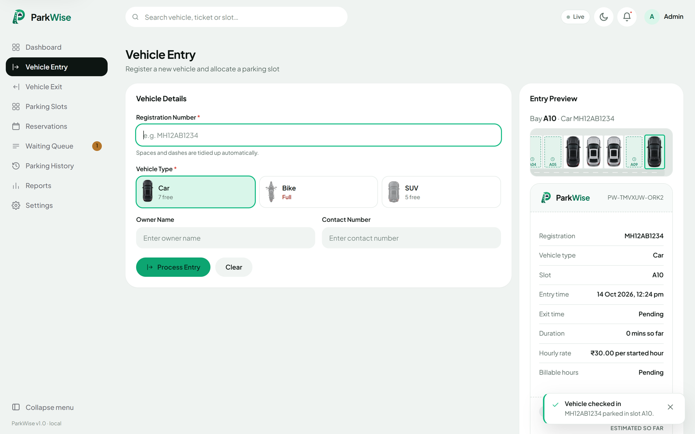 | 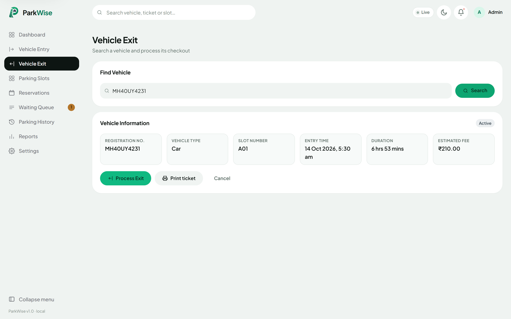 |
| **Reservations** — book, check in, cancel | **Waiting Queue** — FIFO among compatible vehicles |
| 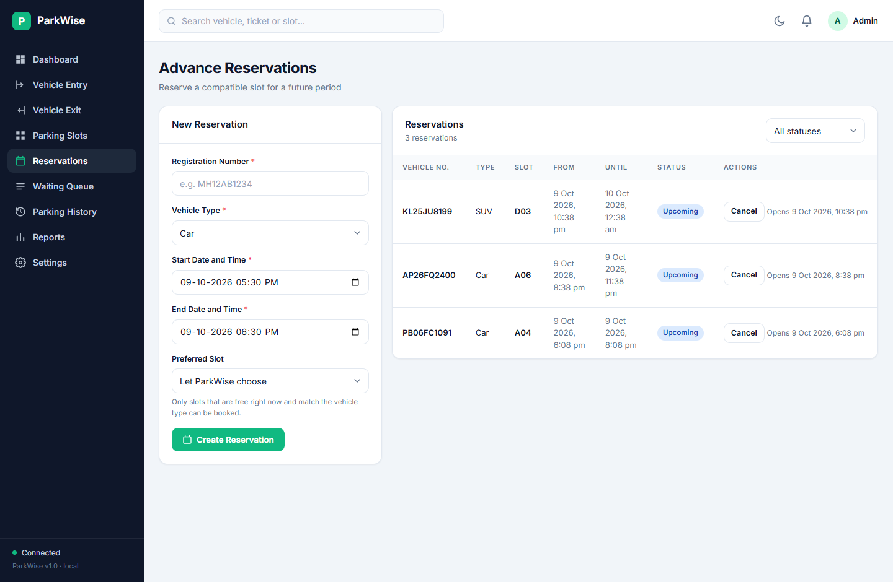 | 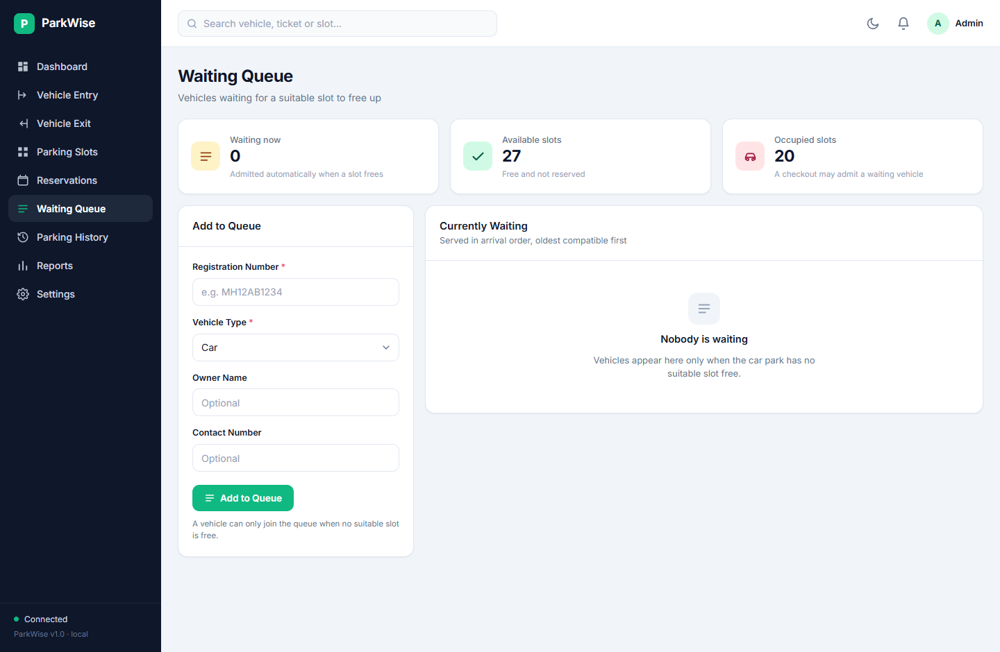 |
| **History** — search, filter, export CSV | **Reports** — revenue, duration, peak hour, charts |
| 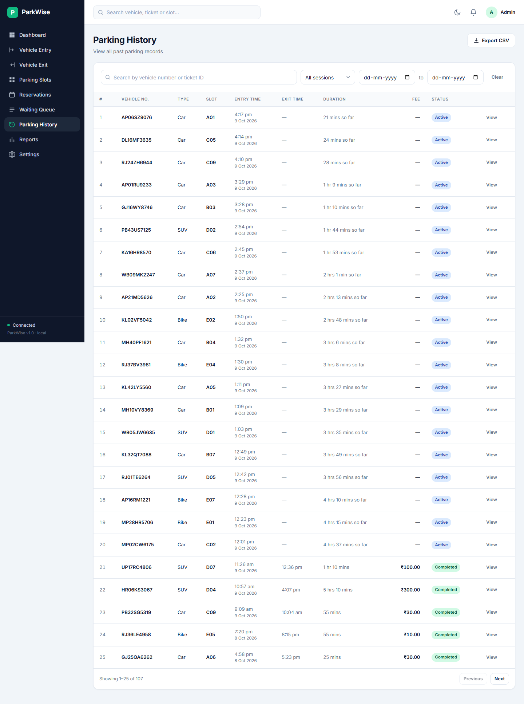 | 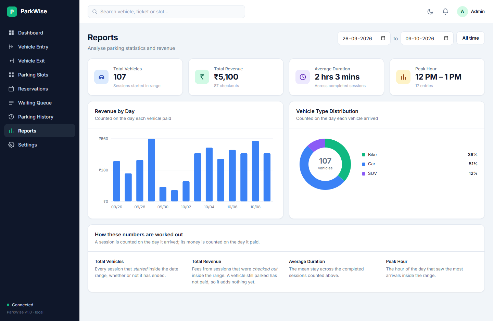 |
| **Settings** — rates, grace period, slot layout | **Dark theme** — toggled from the top bar |
| 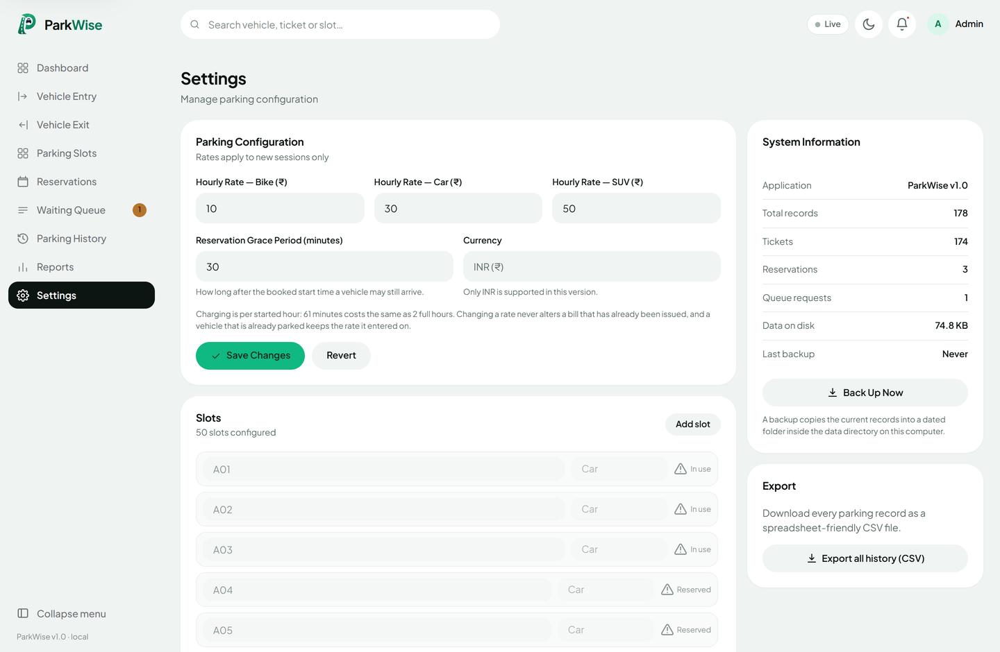 | 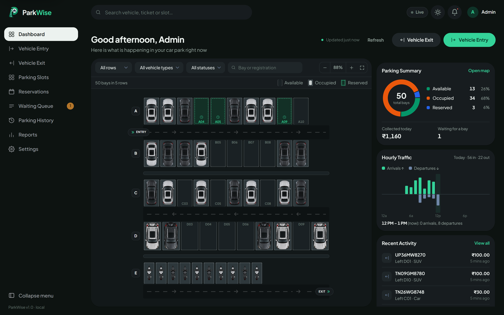 |

A ticket can be printed straight from the browser after check-in. The print
stylesheet drops the interface and leaves only the receipt:

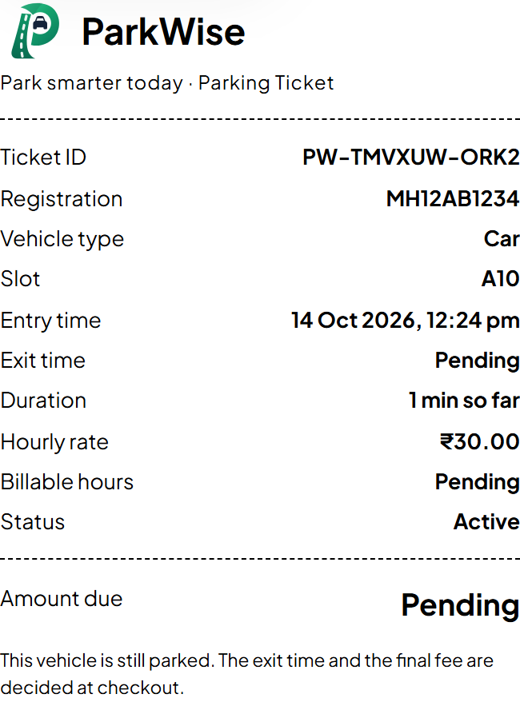

---

## Architecture

Three layers, with a single direction of dependency.

```
┌──────────────────────────────────────────────────────────────┐
│  BROWSER            frontend/                                │
│  index.html · css/styles.css · js/                           │
│                                                              │
│  app.js ──── routing, theme, shell                           │
│  api.js ──── the only place that calls the server            │
│  ui.js ───── buttons, badges, tables, toasts, dialogs        │
│  pages/ ──── one module per screen                           │
│                                                              │
│  Renders what the server says. Decides nothing.              │
└───────────────────────────┬──────────────────────────────────┘
                            │  JSON over HTTP, localhost:8080
┌───────────────────────────▼──────────────────────────────────┐
│  HTTP LAYER         src/ApiServer.cpp                        │
│                                                              │
│  Parses requests, calls the business layer, formats replies, │
│  maps failures onto HTTP status codes. One mutex serialises   │
│  every request, so two clicks cannot claim the same slot.    │
│  Contains no parking or billing logic of its own.            │
└───────────────────────────┬──────────────────────────────────┘
                            │
┌───────────────────────────▼──────────────────────────────────┐
│  BUSINESS LAYER     src/ParkingLot.cpp  ← the core           │
│                                                              │
│   ParkingSlot   ParkingTicket   Reservation   QueueManager   │
│   Vehicle       BillingService  ParkingSettings              │
│   ReportService (read-only summaries over the same data)     │
│                                                              │
│  The single source of truth for every parking decision.      │
└───────────────────────────┬──────────────────────────────────┘
                            │
┌───────────────────────────▼──────────────────────────────────┐
│  PERSISTENCE        src/FileManager.cpp + src/JsonCodec.cpp  │
│                                                              │
│  data/config.json · tickets.json · reservations.json ·       │
│  queue.json · backups/                                       │
│                                                              │
│  Moves records between disk and memory. Decides nothing.     │
└──────────────────────────────────────────────────────────────┘
```

### The shape of every operation

This pattern repeats throughout `ParkingLot`, and it is what lets a success
reply mean the records really are on disk:

```cpp
LotState previousState = state_;   // 1. remember where we were
applyExpiries(now);                // 2. bring reservations up to date
                                   // 3. check everything, bail out on failure
                                   // 4. change the state
Result saved = commitOrRollback(previousState);  // 5. save, or undo and report
```

If the save fails, the in-memory state is put back exactly as it was and the
operation reports `PERSISTENCE_FAILED`. Nothing is ever reported as done
unless it was written.

---

## The C++ classes

| Class | File | Responsibility |
|---|---|---|
| `Vehicle` (+ `Car`, `Bike`, `Suv`) | `Vehicle.h/.cpp` | Abstract base: the plate and owner details every vehicle has, plus the one shared place where registration numbers are cleaned up and validated. Each subclass answers for its own type and hourly rate. |
| `ParkingSlot` | `ParkingSlot.h/.cpp` | One physical space: which vehicle type it takes and whether something is standing in it. It knows nothing about reservations. |
| `ParkingTicket` | `ParkingTicket.h/.cpp` | One session, entry to exit. Captures the hourly rate at entry, which is why later price changes leave old bills alone. |
| `Reservation` | `Reservation.h/.cpp` | A booking over a half-open interval `[start, end)`, with explicit states and guarded transitions. |
| `QueueRequest` / `QueueManager` | `QueueManager.h/.cpp` | The waiting list in arrival order, with the ability to scan past an incompatible vehicle. |
| `BillingService` | `BillingService.h/.cpp` | The one and only fee calculation. All static — billing is a pure calculation. |
| `ParkingSettings` | `ParkingSettings.h/.cpp` | Rates, grace period, currency, and their validation. |
| `ParkingLot` | `ParkingLot.h/.cpp` | **The central class.** Owns all state and is the only thing allowed to change it. |
| `ReportService` | `ReportService.h/.cpp` | Read-only summaries, history filtering and CSV. Separate because it never changes anything. |
| `JsonCodec` | `JsonCodec.h/.cpp` | Translates objects to and from JSON. One description of each record, shared by saving and by the API. |
| `FileManager` | `FileManager.h/.cpp` | Reads and writes the data files safely. Makes no business decisions. |
| `ApiServer` | `ApiServer.h/.cpp` | HTTP routes. Parses, delegates, formats. No parking logic. |
| `DemoMode` | `DemoMode.h/.cpp` | What a published copy allows: which requests are refused, and putting the records back periodically. Off unless `--demo` is passed. |

A full write-up with the reasoning behind each choice is in
**[docs/ARCHITECTURE.md](docs/ARCHITECTURE.md)**.

---

## How billing works

ParkWise bills **per started hour**. Any part of an hour costs a whole hour.

```
billableHours = ceil(durationMinutes / 60)
fee           = billableHours × hourlyRate
```

The duration is whole minutes, so a stay under one minute is free.

At ₹40 per hour:

| Duration | Billable hours | Fee |
|---|---:|---:|
| 0 min | 0 | ₹0 |
| 1 min | 1 | ₹40 |
| 59 min | 1 | ₹40 |
| 60 min | 1 | ₹40 |
| 61 min | 2 | ₹80 |
| 120 min | 2 | ₹80 |
| 121 min | 3 | ₹120 |
| 130 min | 3 | ₹120 |

Every row above is an executed test case in `tests/test_main.cpp`.

**Money is stored as whole paise** (`₹40.00` is `4000`), never as a floating
point number, so totals cannot drift. Rupees appear only in the browser and in
the CSV export.

**The rate is captured on the ticket at entry.** Raising the car rate in
Settings therefore changes nothing about a vehicle already parked, and nothing
about a bill already issued. There is a test for exactly this.

---

## How reservations and the queue interact

This is the subtlest part of the system, so it is worth stating plainly.

**A slot's colour is derived, not stored.** `ParkingSlot` only records whether
a vehicle is physically in it. `ParkingLot::displayStateOf` combines that with
the reservation list:

| Physically occupied? | Has an upcoming booking? | Shown as |
|---|---|---|
| yes | — | **Occupied** (red) |
| no | yes | **Reserved** (blue) |
| no | no | **Available** (green) |

**Reservation rules**

- Intervals are half-open, `[start, end)`. Two bookings that merely touch — one
  ending exactly when the next begins — do not clash.
- A booking can only be made on a slot that is free right now and has no
  conflicting booking.
- While a booking is `UPCOMING` it **holds** its slot. Walk-in vehicles are not
  sent there, and the waiting queue may not be given it either.
- Check-in is allowed from the start time until the grace period runs out
  (30 minutes by default), and never past the end of the booked interval.
- Miss that window and the booking becomes `EXPIRED` and releases its hold. The
  sweep runs at the start of every request, so the state is never stale.

**Queue rules**

- A vehicle may only join the queue when no suitable slot is actually free.
- Whenever a slot becomes usable, the **oldest compatible** waiting vehicle
  takes it. If the oldest waiter is a bike and a car space opened up, the queue
  scans past it rather than leaving a usable space empty.
- There are four ways a slot becomes usable, and all four serve the queue: a
  **checkout**, a **cancelled** booking, an **expired** booking, and **capacity
  added** in Settings. The rule this enforces is that a vehicle is never left
  waiting while a slot it could use stands empty.
- A released slot that another booking is holding is **not** given to the queue.
- The expiry sweep that runs at the start of every request also offers free
  slots to the queue, so the waiting list is correct whenever anyone looks.
- An admitted vehicle is treated as having entered: it gets a real ticket, and
  the checkout response tells the browser so the grid updates correctly.

This is why `QueueManager` uses a `std::vector` rather than a `std::queue` — a
strict FIFO cannot scan past an incompatible request or cancel from the middle.

---

## How data is stored

Records live in `data/`, outside the frontend folder, in four JSON files:

| File | Holds |
|---|---|
| `config.json` | Rates, grace period and the slot layout |
| `tickets.json` | Every session, active and completed |
| `reservations.json` | Every booking and its state |
| `queue.json` | Waiting, assigned and cancelled requests |

Alongside them, `data/backups/` holds dated folders created by **Back Up Now**,
and each file has a `.bak` sibling holding the previous good version. Only the
ten most recent backup folders are kept — each new one removes the oldest, so
the data folder cannot grow without limit.

### What protects the records

- **A missing file is fine** — it means a first run, and the default 50-slot
  layout is created.
- **A damaged or empty file is a hard stop.** The program refuses to start,
  names the file, and changes nothing. Starting blank and then saving over a
  corrupt file would destroy the very records worth keeping.
- **Saving happens in two passes.** All four files are written as `.tmp` first;
  only when every one has succeeded are they moved into place, each keeping a
  `.bak` of what it replaced.
- **A failed save undoes itself**, in memory as well as on disk, and the API
  returns `500 PERSISTENCE_FAILED`.
- **Occupancy is rebuilt from the tickets on startup**, not trusted from the
  slot flags, so a crash cannot leave a slot disagreeing with its ticket.

Timestamps are Unix epoch seconds everywhere. The browser converts to and from
local time for display.

---

## API reference

Base URL `http://127.0.0.1:8080/api`. Full details, with request and response
bodies, are in **[docs/API.md](docs/API.md)**.

| Method | Path | Purpose |
|---|---|---|
| `GET` | `/dashboard` | Summary, slot grid, recent activity, bookings, queue |
| `GET` | `/slots` · `/slots/{id}` | Slot states and one slot's details |
| `POST` | `/vehicles/entry` | Register a vehicle and allocate a slot |
| `POST` | `/vehicles/exit` | Check out, bill, and process the queue |
| `GET` | `/tickets/lookup?query=` · `/tickets/{id}` | Find a session |
| `GET`/`POST` | `/reservations` | List or create bookings |
| `POST` | `/reservations/{id}/cancel` · `/check-in` | Change a booking |
| `GET`/`POST` | `/queue` | List or join the waiting line |
| `DELETE` | `/queue/{id}` | Leave the waiting line |
| `GET` | `/history` · `/reports` | Filtered records and summaries |
| `GET` | `/exports/history.csv` | CSV of the current filter |
| `GET`/`PUT` | `/settings` | Read or change configuration |
| `POST` | `/settings/backup` | Take a backup |

Errors are always shaped the same way:

```json
{ "error": { "code": "RESERVATION_CONFLICT",
             "message": "Slot A01 is already reserved during part of that time." } }
```

`400` invalid request · `404` unknown resource · `409` conflict with the current
state · `500` an unexpected failure. Stack traces and file paths are never sent
to the browser.

---

## OOP concepts demonstrated

**Abstraction and inheritance.** `Vehicle` is an abstract base class — it
declares `type()` and `hourlyRate()` as pure virtual and so cannot be created
on its own. `Car`, `Bike` and `Suv` each inherit from it and answer for their
own kind. The destructor is `virtual` because vehicles are held and destroyed
through `std::unique_ptr<Vehicle>`.

**Polymorphism.** `ParkingLot::startSession` asks `vehicle.hourlyRate(settings)`
without knowing which kind of vehicle it holds, and gets the right rate back.
`testVehicleKinds` in the test suite proves it: it puts a `Car`, a `Bike` and
an `Suv` into one `std::vector<std::unique_ptr<Vehicle>>` and asserts that the
same call returns three different rates.

**Encapsulation.** Every entity keeps its data private and exposes behaviour.
`ParkingTicket::complete()` is the only way a ticket can be closed, and it
refuses a second attempt — which is what makes a repeated checkout impossible
rather than merely discouraged. `Reservation::cancel()`, `expire()` and
`checkIn()` each return `false` from a state they are not allowed to leave.

**Composition.** `ParkingLot` *has* slots, tickets, reservations, a
`QueueManager` and a `ParkingSettings`. Building the system out of parts that
each own one job is what keeps any single file readable.

**Constructors.** Entities are constructed valid. A second, named constructor —
`ParkingTicket::fromStoredValues(...)` — exists for rebuilding an object from a
saved record, which is a genuinely different job from creating a new one.

**STL containers.** `std::vector` for slots, tickets, reservations and the
queue; `std::map` for grouping report rows by day; `std::set` for detecting
duplicate slot IDs; `std::mt19937_64` for the random part of an ID.

**File handling.** `std::ifstream` and `std::ofstream` through `FileManager`,
with `std::filesystem` for the temporary-file-then-rename dance.

**Static members as a deliberate choice.** `BillingService` is entirely static
because billing has no state to keep — it is a calculation over its arguments.
Making it an object with nothing in it would be ceremony without benefit.

### How the Vehicle hierarchy came about

The first version did not have one. `Vehicle` was a single concrete class, the
type was an `enum class`, and the hourly rate came from a `switch` inside
`ParkingSettings::rateFor`. That worked, and for a while I defended it: the
three types differed in exactly one value, so a hierarchy looked like ceremony.

What changed my mind was watching where the `switch` wanted to spread. Asking
`ParkingSettings` what a vehicle costs puts the question in the wrong place —
the settings object has to know about every kind of vehicle that exists, and
each new kind means editing a function that has nothing to do with that kind.
The vehicle is the thing that knows what it is; it should be the thing that
answers.

So `Vehicle` is now an abstract base. It holds what every vehicle shares — the
plate, the owner details, the rules for validating them — and declares what
differs as pure virtual:

```cpp
class Vehicle {
public:
    virtual ~Vehicle() = default;
    virtual VehicleType type() const = 0;
    virtual Paise hourlyRate(const ParkingSettings& settings) const = 0;
    // ... plate, owner, contact, and the shared validation helpers
};

class Suv : public Vehicle {
public:
    using Vehicle::Vehicle;
    VehicleType type() const override { return VehicleType::SUV; }
    Paise hourlyRate(const ParkingSettings& s) const override {
        return s.suvHourlyRatePaise;
    }
};
```

`ParkingSettings::rateFor` is gone. `ParkingLot::startSession` now says

```cpp
const Paise rate = vehicle.hourlyRate(state_.settings);
```

— one line that gives three different answers depending on what is parked, and
needs no change at all when a fourth kind of vehicle is added.

**What it did and did not buy.** It removed one `switch` and replaced it with
one virtual call. It did *not* remove the others: the JSON codec still has to
turn the string `"SUV"` into something, and the UI dropdown still lists three
options. Those are boundaries where the program meets stored text and a human,
and a type system cannot cross them for you. `Vehicle::create(...)` is the
single factory where that crossing happens, and it is deliberately the only
`switch` on vehicle type left in the vehicle code.

The honest summary is that the hierarchy is small, and it earns its place by
putting one question with the object that can answer it — not by being large.

---

## A five minute demo

1. `run.bat`, then open http://127.0.0.1:8080. The facility starts with 50
   slots and no history.
2. **Vehicle Entry** → type `mh 12-ab 1234`, pick *Car*, Process Entry. Note
   the plate is tidied to `MH12AB1234` and a slot is allocated. Print the ticket.
3. Submit the **same plate again** — it is refused as already parked, and your
   typing is preserved.
4. **Vehicle Exit** → search `MH12AB1234`. The confirmation dialog shows the
   fee before you commit. Confirm, and watch the dashboard counts change.
5. **Reservations** → book a slot starting in an hour. Go to **Parking Slots**
   and see it shown as *Reserved* while still being physically empty.
6. **Settings** → try to delete that reserved slot. The server refuses it.
7. Change the car rate to ₹90 and save. Check in a car, then look at **History**
   — older completed bills still show their original amounts.
8. **Reports** → the revenue, average duration and peak hour all come from the
   records you just created.
9. Stop the server with `Ctrl+C` and run it again. Everything is still there.

---

## Known limitations

These are deliberate boundaries for version 1, stated honestly rather than
hidden:

- **No authentication.** Anyone who can reach `127.0.0.1:8080` has full access.
  The brief places user accounts outside this version's scope. `--demo` narrows
  what a stranger can do on a published copy, but it is not a login: it refuses
  two endpoints and resets the records, nothing more.
- **Single facility, single operator.** There is no concept of multiple car
  parks or of who performed an action.
- **A slot accepts exactly one vehicle type.** A bike cannot use a spare car
  space. This keeps allocation predictable; a size hierarchy would be the
  natural next step.
- **Reservations need a slot that is free at the moment of booking.** You cannot
  book tomorrow morning for a slot occupied right now, even though it will
  almost certainly be free by then. This is the version 1 rule from the brief.
- **Four files, not one transaction.** Each file is written atomically and all
  four are staged before any is replaced, so a failure almost always leaves the
  previous records intact — but a crash in the middle of the final four renames
  could still leave a mixed set. The `.bak` copies exist for exactly that case.
  A single file, or a real database, would close the gap entirely.
- **The whole history is loaded into memory.** Fine for a college project and
  for tens of thousands of records; not how you would build it for a year of a
  busy airport.
- **Reservation expiry is checked on request, not on a timer.** If nobody opens
  the app, a lapsed booking is marked expired the next time anyone does. The
  derived state is always correct when it is read, which is what matters.
- **The clock is the computer's local clock.** Changing the system time while a
  vehicle is parked will affect its bill; a backwards jump is clamped so the fee
  can never go negative.

---

## Project layout

```
ParkWise/
├── CMakeLists.txt          Build configuration
├── build.bat  run.bat  test.bat
├── README.md
├── docs/
│   ├── ARCHITECTURE.md     Class responsibilities and design decisions
│   ├── API.md              Full endpoint reference
│   ├── VIVA.md             Questions and answers for the viva
│   └── screenshots/
├── include/                One header per class
├── src/                    Implementations + main.cpp
├── tools/
│   └── seed_demo.py        Writes a sample day into a data folder
├── Dockerfile              Builds, tests, seeds and runs in demo mode
├── tests/
│   └── test_main.cpp       320 business rule checks
├── third_party/            cpp-httplib and nlohmann/json (header only)
├── frontend/
│   ├── index.html
│   ├── assets/
│   │   ├── logo-mark.svg   The mark on its own
│   │   ├── logo.svg        Full lockup, light backgrounds
│   │   ├── logo-dark.svg   Full lockup, dark backgrounds
│   │   ├── favicon.svg     The mark on a brand tile, for browser tabs
│   │   └── vehicles/       Top-down car, bike and SUV renders for the map
│   ├── css/styles.css      The whole design system
│   └── js/
│       ├── app.js          Routing and shell
│       ├── api.js          Every call to the server
│       ├── ui.js           Shared components
│       ├── facility.js     The top-down car park
│       ├── format.js       Money, dates, durations, escaping
│       ├── ticket.js       Ticket panel and printing
│       └── pages/          One module per screen
└── data/                   Created at runtime; not in version control
```
